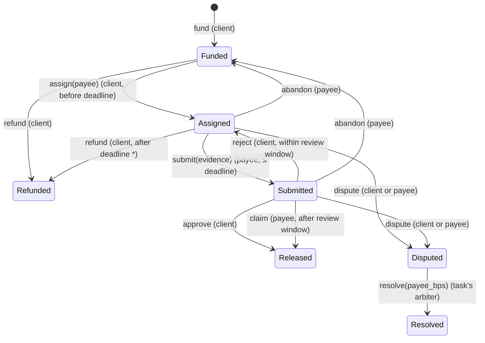

# Escrow contract

Source: [`contracts/escrow/src/lib.rs`](../../contracts/escrow/src/lib.rs) · Tests: [`test.rs`](../../contracts/escrow/src/test.rs) (41 tests) · SDK: `soroban-sdk 29.0.1`

The contract holds one client bounty per task id and releases it only through the paths below. It never judges whether work is correct: approval is an authorized signature, not a proof of quality. Work verification happens off-chain (see [architecture](../architecture/overview.md)).

> Not independently audited. Testnet only.

## State machine



\* After a rejection, refund also waits until the payee has had one full review window to dispute it.

## Interface

| Function | Signer | Effect |
|---|---|---|
| `__constructor(admin, arbiter, review_window, tokens)` | deployer (at deploy time) | Configuration; cannot be front-run |
| `fund(task_id, client, token, amount, deadline)` | client | Transfers `amount` into escrow; `task_id` can be funded once ever |
| `assign(task_id, payee)` | client | Names the account to be paid |
| `submit(task_id, evidence)` | payee | Records the 32-byte submission digest; starts the review window |
| `reject(task_id)` | client | Back to Assigned; counts rejections |
| `approve(task_id)` | client | Pays the full amount to the payee |
| `claim(task_id)` | payee | Pays the payee once the review window has passed with no decision |
| `abandon(task_id)` | payee | Withdraws; task returns to Funded |
| `refund(task_id)` | client | Returns funds (rules above) |
| `dispute(task_id, by)` | `by` (client or payee) | Freezes funds for the arbiter |
| `resolve(task_id, payee_bps)` | task's arbiter | Splits funds: `amount × bps / 10000` to payee, exact remainder to client |
| `set_arbiter`, `set_review_window`, `set_token_allowed` | admin | Affect **future** tasks only |
| `get_task`, `get_config`, `is_token_allowed`, `bump` | anyone | Views; `bump` extends a task's storage TTL |

Limits: deadline within 90 days of funding; review window between 60 seconds and 30 days.

## Authorization model

- Every state change calls `require_auth()` on exactly one address: the party named in the table.
- The arbiter and review window are **copied into the task at funding time**. The admin can change them for future tasks but cannot change the rules for money already in escrow, and has no function that moves escrowed funds.
- Tokens must be on the allowlist (testnet deployment: native XLM's Stellar Asset Contract). This avoids arbitrary token contracts with surprising transfer behaviour.

## Safety properties (each covered by tests)

- **No double payment:** a payout moves the task to a terminal state before the token transfer; any second approve/claim/refund/resolve fails with `InvalidState`.
- **No replay:** a task id can only ever be funded once, even after it is refunded.
- **No unauthorized movement:** tests sign with every wrong party for each money-moving function and assert failure with balances unchanged.
- **Exact splits:** `resolve` sends the remainder to the client, so no stroop is lost to rounding (tested with an odd amount and 33.33%).
- **Re-entrancy:** Soroban forbids re-entering a contract during its own execution; the contract also updates state before transferring.
- **Frozen disputes:** while Disputed, approve, claim, refund and abandon all fail.

## Errors

`1 TaskExists · 2 TaskNotFound · 3 InvalidAmount · 4 TokenNotAllowed · 5 InvalidDeadline · 6 InvalidState · 7 DeadlinePassed · 8 DeadlineNotPassed · 9 ReviewWindowOpen · 10 InvalidBps · 11 NotParty · 12 InvalidPayee · 13 InvalidConfig · 14 ReviewWindowClosed`

## Events

All events have the event name as the first topic and the task id as the second: `funded`, `assigned`, `submitted`, `rejected`, `abandoned`, `released` (with `by_timeout`), `refunded`, `disputed`, `resolved` (with both amounts). The API's worker indexes them.

## Trust assumptions and known limitations

- **Arbiter:** a single address chosen by the deployment. It can split disputed funds arbitrarily within a dispute; it cannot touch undisputed tasks. If it never rules, disputed funds stay locked. A multisig arbiter is on the roadmap.
- **Client discretion:** a client can reject repeatedly within each review window until the deadline. The agent's remedy is a dispute; the reference agent disputes automatically when its output matches the platform's recomputation.
- **Ledger time:** deadlines use ledger close time, which validators set within protocol bounds.
- **Storage TTL:** task entries are extended on every write; long-idle tasks can be extended by anyone with `bump`.

## Build, test, deploy

```bash
cd contracts
cargo test --locked
cargo clippy --all-targets -- -D warnings
stellar contract build            # → target/wasm32v1-none/release/agentflow_escrow.wasm
bash ../scripts/deploy-testnet.sh # deploys with the native XLM SAC allowlisted
```
