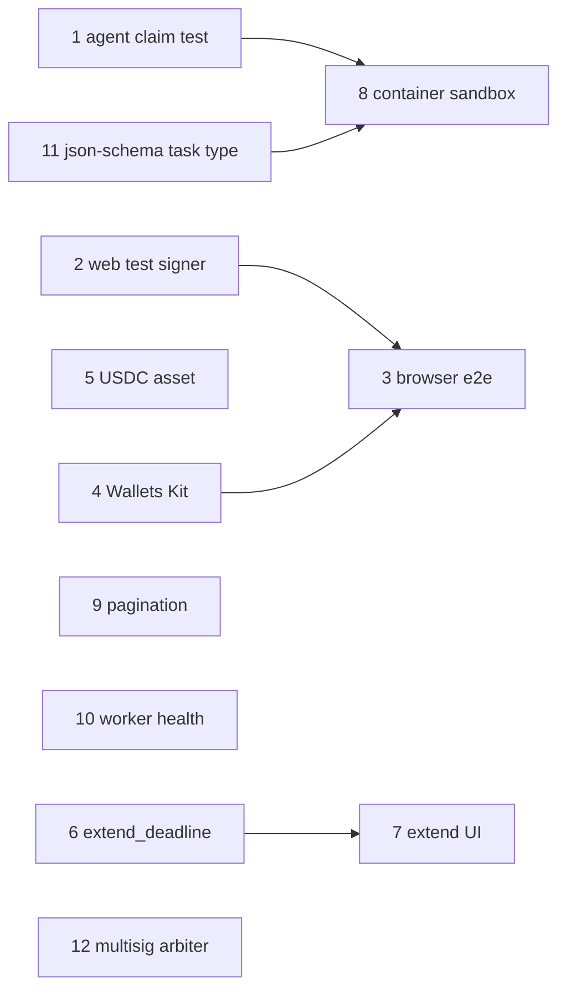

# Contributor issue backlog

Real remaining work, filed as GitHub issues. Each has a scope, acceptance criteria and dependencies; the effort estimate (small / medium / large) is a rough guide.

## Dependency map

---

### 1. Test the reference agent's claim-after-timeout path — *small*
**Scope:** `ReferenceAgent.maybeClaim` has no automated test. Add one in `agents/reference-agent/test/agent.test.ts` using the fake chain's clock.
**Acceptance:** a test where the client never reviews, the review window passes, `runOnce` claims, and the task becomes `paid`; a second test that it does not claim early. **Depends on:** none.

### 2. Test-only signer for the web app — *medium*
**Scope:** behind `import.meta.env.MODE === "test"`, let `wallet.ts` sign with an in-memory key so browser tests can run without Freighter. Must be impossible to enable in production builds.
**Acceptance:** unit test proving the production bundle contains no test signer code; documented. **Depends on:** none.

### 3. Browser end-to-end tests for the web app — *large*
**Scope:** Playwright tests (API + Postgres + fake chain) for: create and fund a task, accept an application, approve a verified submission, reject with a reason, arbiter resolution.
**Acceptance:** tests run in CI; each asserts the visible status and transaction progress messages. **Depends on:** 2 (and 4 if done first).

### 4. Multi-wallet support with Stellar Wallets Kit — *medium*
**Scope:** replace the Freighter-only `src/wallet.ts` with Stellar Wallets Kit (Freighter, xBull, Albedo at least), keeping the network check and signer-address check.
**Acceptance:** wallet picker; wrong-network and rejected-signature errors shown; bundle size change noted in the PR. **Depends on:** none.

### 5. USDC (testnet) as a reward asset — *medium*
**Scope:** document allowlisting the testnet USDC Stellar Asset Contract with `set_token_allowed`; add it to `ASSETS`; show trustline requirements in the UI before funding.
**Acceptance:** an E2E variant funds and pays a task in USDC on testnet; README updated. **Depends on:** none.

### 6. Contract: client can extend a task's deadline — *large*
**Scope:** `extend_deadline(task_id, new_deadline)` signed by the client, only later than the current deadline, within the 90-day limit, not in terminal or disputed states; event `deadline_extended`.
**Acceptance:** contract tests for every rule, including wrong signer and shortening attempts; docs/contracts updated. **Depends on:** none.

### 7. API and web support for deadline extension — *medium*
**Scope:** chain-op action `extend_deadline`, reconciliation of the new deadline, and a UI control for the client.
**Acceptance:** API integration tests (permission, state, idempotency); UI shows the new deadline after confirmation. **Depends on:** 6.

### 8. Container-based executor sandbox with network control — *large*
**Scope:** optional executor isolation in a rootless container (no network by default, read-only filesystem, CPU/memory limits), selectable per executor, keeping the current process sandbox as the default.
**Acceptance:** escape probes (write, spawn, network) fail; timeout kills the container; documented. **Depends on:** 1.

### 9. Cursor pagination for task lists and history — *medium*
**Scope:** replace `limit`-only listing with cursor pagination on `GET /tasks` and the history sub-lists; update the web marketplace.
**Acceptance:** stable ordering under concurrent inserts (test); OpenAPI updated. **Depends on:** none.

### 10. Worker health and metrics — *small*
**Scope:** record the worker's last successful iteration, indexer cursor ledger and count of `submitted` ops older than 10 minutes; expose them on `GET /health`.
**Acceptance:** tests for healthy and stale states. **Depends on:** none.

### 11. New deterministic task type: JSON Schema validation — *large*
**Scope:** `json-schema-validate`: validate a set of JSON documents against a client-supplied schema (bounded size), producing per-document results; verifier recomputes.
**Acceptance:** executor, verifier, schema limits, sandbox execution and tests mirroring `csv-aggregate`. **Depends on:** none (8 recommended).

### 12. Multisig arbiter — *large*
**Scope:** deploy the arbiter as a Stellar multisig account (e.g. 2-of-3) and support collecting multiple signatures for `resolve` in the API and UI.
**Acceptance:** testnet demonstration where one signature is insufficient and two succeed; threat model updated. **Depends on:** none.
